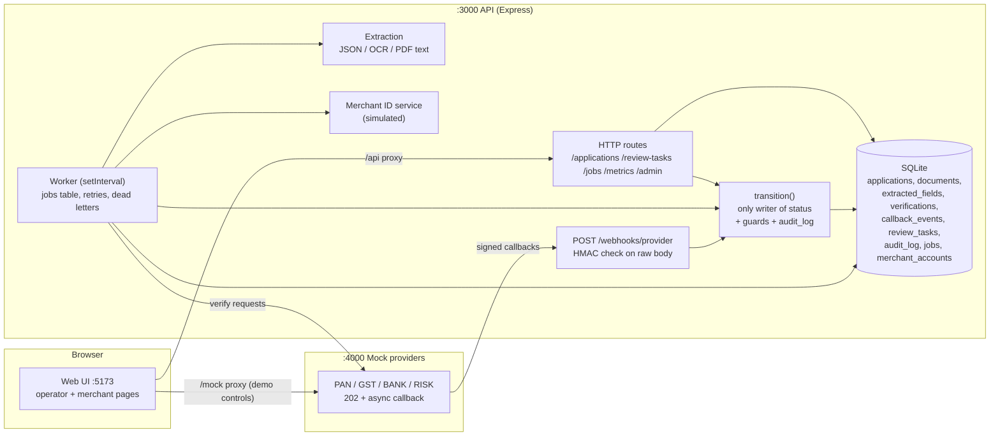
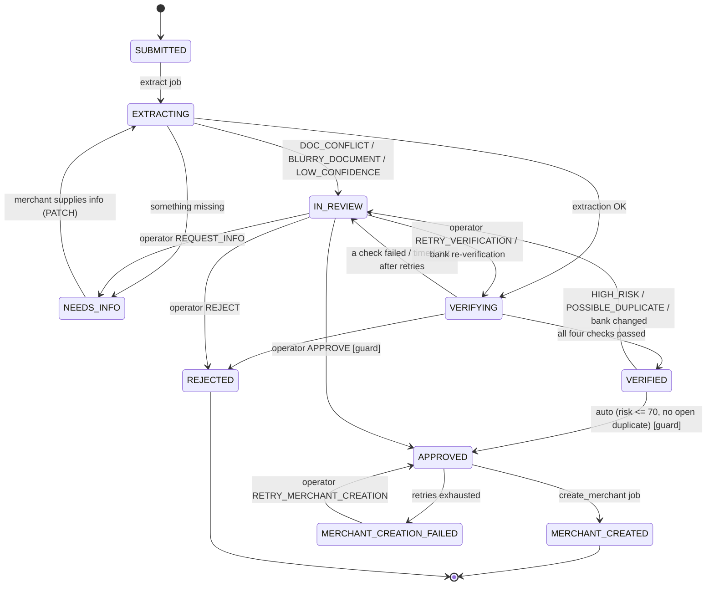
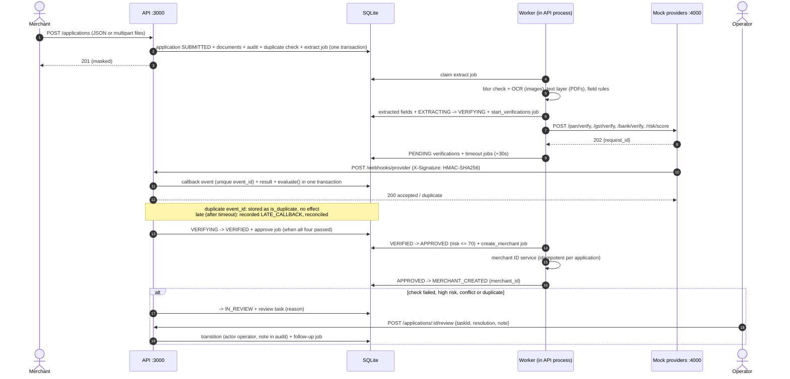

# Autonomous Merchant Onboarding Platform

A working vertical slice of merchant onboarding for a payment company. A
merchant submits an application with documents (structured JSON, images or
PDFs). The system extracts and validates the fields, calls simulated PAN, GST,
bank and risk providers that answer asynchronously through signed webhooks,
and tracks every step in an explicit state machine. It then either approves
the merchant and issues a merchant ID, or sends the case to a human with a
clear reason. Every step is in an audit trail, and sensitive values are
masked everywhere.

- **API** (`api/`, Express 5, SQLite via Drizzle, port 3000): intake, extraction (JSON, OCR, PDF text), state machine, background job worker, webhook, review, metrics.
- **Mock providers** (`mock-providers/`, port 4000): PAN, GST, bank and risk services with configurable failure modes ("chaos").
- **Web** (`web/`, React 19 + Vite + Tailwind v4, port 5173): operator console with a sidebar (Applications, Review queue, Submit application, Dead letters, Demo controls), global search, plain-language statuses and reasons, confirm dialogs for every reviewer action, 404 / error pages and an offline banner. Design tokens and primitives live in `web/src/index.css` and `web/src/components/ui.tsx`; the codes-to-words mapping in `shared/src/labels.ts`.
- **Shared** (`shared/`, Zod): wire schemas, the state machine table, validators and masking, used by all three.

Brief: [docs/PROBLEM.md](docs/PROBLEM.md). Build plan: [docs/PLAN.md](docs/PLAN.md). Build log and decisions: [docs/PROGRESS.md](docs/PROGRESS.md). **Every requirement and scenario of the brief, with how to demo it in the website: [docs/REQUIREMENTS.md](docs/REQUIREMENTS.md).** Live demo script: [docs/DEMO.md](docs/DEMO.md).

## Quick start (Fedora)

```sh
sudo dnf install -y nodejs npm git        # Node 20+ (developed on Node 24)
git clone https://github.com/shreyan-naskar/Autonomous-Merchant-Onboarding-Platform.git
cd Autonomous-Merchant-Onboarding-Platform
npm install                               # better-sqlite3 and sharp ship prebuilt binaries; no extra dnf packages needed
cp .env.example .env                      # optional: every value is also a built-in default

npm test                                  # 577 tests (the real-OCR one is skipped until the model is cached)
npm run build                             # api + mock-providers (tsc) and web (tsc + vite build)
npm run demo                              # starts API + mock providers on a fresh DB and runs the scripted demo
npm run dev                               # API :3000, mock providers :4000, web :5173 -> open http://localhost:5173
```

- The database is created and migrated on first start (`api/data/app.db`; the demo uses `api/data/demo.db`).
- `npm run demo` starts its own services when ports 3000 and 4000 are free. If `npm run dev` is already running, it uses those and resets their data instead. See [Demo](#demo).
- OCR (uploaded images only) downloads the Tesseract English model (~10 MB) on first use into `api/.ocr-cache/`. JSON documents and PDFs need no download.
- `npm run typecheck` checks all four workspaces.

## Architecture

### Components



### Application state machine

`ALLOWED_TRANSITIONS` in [shared/src/domain.ts](shared/src/domain.ts) is enforced by `transition()` in [api/src/domain/transition.ts](api/src/domain/transition.ts). Every move into `APPROVED` also passes a guard: PAN, GST, BANK and RISK must all be `PASSED`, and the BANK check must be for the current bank details.



### Submit to callbacks to approval



### Key design points

- **One writer of status.** Only `transition()` changes `applications.status`. It checks the edge, runs guards, and writes the audit row in the caller's transaction. A test scans the source to keep it that way ([api/src/security.test.ts](api/src/security.test.ts)).
- **Durable jobs without a broker.** A `jobs` table plus an in-process worker: atomic claim, exponential backoff, `dead` status as the dead-letter queue with a `JOB_DEAD` review task, and requeue from the UI. Handlers are idempotent, so a retried job resumes safely.
- **Idempotent callbacks.** Each callback is checked by HMAC over the raw body, and the `event_id` is unique among non-duplicate rows. A redelivery is stored as `is_duplicate` and answered 200 with no effect. Applying a callback commits in the same transaction as storing it.
- **Late and stale callbacks.** A result that arrives after its timeout is still recorded (`LATE_CALLBACK`) and replaces the pending retry. A BANK result for old bank details is recorded as `STALE_CALLBACK` and ignored.
- **Human in the loop.** Every exception creates a review task with a reason and a note. The operator's options depend on the application's state (`resolutionsFor`, shared by the API and the UI), and every operator action requires a note.
- **Masking at the edge.** One response mapper ([api/src/http/dto.ts](api/src/http/dto.ts)) masks sensitive values to their last 4 characters. pino redaction plus a text scrubber protect the logs.

## API summary

API on `:3000` (JSON, snake_case). The web UI reaches it through the Vite proxy at `/api`.

| Method and path | Purpose |
|---|---|
| `POST /applications` | Submit. JSON `{merchant_name, pan, gst, bank_account, ifsc, documents:[{type, payload}]}`, or multipart with `PAN_CARD` / `GST_CERT` / `BANK_PROOF` files (PNG, JPEG, PDF, max 5 MB) plus an optional `documents` JSON field. Returns 201 with the detail. |
| `GET /applications?status=&limit=` | List: status, time in state, open review count, merchant ID. |
| `GET /applications/:id` | Detail: documents, extracted fields (confidence, validation status), verifications, callbacks, review tasks, audit log. Values masked. |
| `PATCH /applications/:id` | Merchant edit, JSON or multipart (form fields as text parts, files named `PAN_CARD` / `GST_CERT` / `BANK_PROOF`, optional `documents` JSON part; this is what the "Information needed" panel sends). In `NEEDS_INFO`, fields, documents and files restart extraction; documents and files are refused (409) elsewhere, and a replaced upload is deleted. A bank change after verification starts bank re-verification. Edits are refused (409) once approved. |
| `POST /applications/:id/review` | Operator decision `{taskId, resolution, note}`. `resolution` is one of `APPROVE`, `REJECT`, `REQUEST_INFO`, `RETRY_VERIFICATION`, `RETRY_MERCHANT_CREATION` or `DISMISS`. 409 for an illegal state or a failed approval guard; 400 without a note. |
| `GET /review-tasks?status=OPEN\|RESOLVED` | Review queue across applications. |
| `GET /jobs?status=dead` | Dead-letter jobs (payloads masked). |
| `POST /jobs/:id/requeue` | `{note}`. Moves a dead job back to the queue with attempts reset. |
| `GET /metrics` | Total, exception rate, average time per state. |
| `POST /webhooks/provider` | Provider callbacks. `X-Signature` = hex HMAC-SHA256 of the raw body, otherwise 401. |
| `GET/POST /admin/merchant-service` | Demo: `{fail: boolean}` makes merchant ID creation fail. |
| `POST /admin/reset-data` | Demo: delete all data (only when `DEMO_MODE=true`, otherwise 404). |
| `GET /health` | Liveness. |

Mock providers on `:4000` (web proxy `/mock`):

| Method and path | Purpose |
|---|---|
| `POST /pan/verify`, `/gst/verify`, `/bank/verify`, `/risk/score` | Return 202 `{request_id}`, then call back the API with a signed `{event_id, request_id, kind, result, application_ref, bank_version?}` |
| `GET/POST /admin/config` | Chaos settings: `delayMs`, `failKinds`, `duplicateCallback`, `dropCallback`, `lateCallbackMs`, `outage` (every verify request answered 503) |
| `POST /admin/reset` | Restore the default settings |
| `POST /admin/redeliver` | `{event_id?}`. Resend an already-delivered callback byte for byte (a provider retry) |

Magic values in the mocks: PAN `ZZZZZ9999Z` fails, a GSTIN ending in `Z9` fails, a bank account ending in `0000` never calls back, and a merchant name containing `RISKY` gets risk score 85. Samples: [sample-data/README.md](sample-data/README.md).

## Failure scenarios

Each failure scenario from the brief has one clearly named end-to-end test in [api/src/scenarios.test.ts](api/src/scenarios.test.ts). These tests use real HTTP, signed mock callbacks and the worker on a fake clock. Each scenario also has more detailed tests elsewhere.

| Brief scenario | Named test (`api/src/scenarios.test.ts`) | Outcome | More detail |
|---|---|---|---|
| PAN verification succeeds but GST fails | `SCENARIO 1 - PAN passes, GST fails` | `IN_REVIEW`, task `PAN_OK_GST_FAILED`, no merchant ID | [api/src/verification/flow.test.ts](api/src/verification/flow.test.ts), [api/src/verification/evaluate.test.ts](api/src/verification/evaluate.test.ts) |
| The same callback arrives multiple times | `SCENARIO 2 - duplicate callback` | Every redelivery stored as `is_duplicate`, answered 200, one effect per event | [api/src/http/webhooks.test.ts](api/src/http/webhooks.test.ts), [api/src/verification/flow.test.ts](api/src/verification/flow.test.ts) |
| A callback arrives after the request timed out | `SCENARIO 3 - late callback after timeout` | `LATE_CALLBACK` recorded, result applied, retry superseded, app completes | [api/src/verification/flow.test.ts](api/src/verification/flow.test.ts), [api/src/verification/callback.test.ts](api/src/verification/callback.test.ts) |
| Merchant changes bank details after verification | `SCENARIO 4 - bank details changed after verification` | `bank_version` 2, old BANK result superseded, approval 409 `GUARD_FAILED` until the new account passes | [api/src/approval/flow.test.ts](api/src/approval/flow.test.ts) |
| Approval succeeds but merchant ID creation fails | `SCENARIO 5 - approval OK but merchant ID creation fails` | Retries with backoff, then `MERCHANT_CREATION_FAILED` with a task; operator retry leads to `MERCHANT_CREATED` | [api/src/merchant/merchant.test.ts](api/src/merchant/merchant.test.ts), [api/src/approval/flow.test.ts](api/src/approval/flow.test.ts) |
| A document conflicts with the application form | `SCENARIO 6a - conflicting document` | `IN_REVIEW`, task `DOC_CONFLICT` (PAN card name does not match the form), no provider calls | [api/src/extraction/flow.test.ts](api/src/extraction/flow.test.ts), [api/src/extraction/extract.test.ts](api/src/extraction/extract.test.ts) |
| A document is blurred | `SCENARIO 6b - blurred document image` | Blur score below threshold: `IN_REVIEW`, task `BLURRY_DOCUMENT`, no OCR | [api/src/extraction/ocr.flow.test.ts](api/src/extraction/ocr.flow.test.ts), [api/src/extraction/blur.test.ts](api/src/extraction/blur.test.ts) |

Run only these: `npx vitest run api/src/scenarios.test.ts`.

## Demo

`npm run demo` ([scripts/demo.ts](scripts/demo.ts)) runs the minimum successful demonstration and exits non-zero if any check fails:

1. Resets the data. It starts the API and mock providers on a fresh `api/data/demo.db`, or uses running ones and calls `POST /admin/reset-data`.
2. Takes `happy.json` through extraction, four async callbacks, `VERIFIED`, `APPROVED` and `MERCHANT_CREATED`.
3. Has the mock provider redeliver one callback. The API answers `duplicate` and nothing changes.
4. Takes `gst-fail.json` to `IN_REVIEW` (`PAN_OK_GST_FAILED`). An operator reject with a too-short note is refused; with a proper note the app is `REJECTED`.
5. Prints both audit trails as tables (values masked) and the metrics.
6. When it started the services itself, scans the API debug log for raw PAN, GSTIN and account numbers.

Flags: `--external` requires running services; `--spawn` always starts its own. Click-by-click live demo with curl fallbacks: [docs/DEMO.md](docs/DEMO.md).

## Repository layout

```
api/              Express API, worker, extraction, state machine (src/), migrations (drizzle/)
mock-providers/   Simulated PAN/GST/bank/risk services with chaos settings
web/              React operator + merchant UI
shared/           Zod schemas, domain vocabulary, validators, masking
scripts/          demo.ts, walk.ts (state machine walk), generate-sample-images.mts
sample-data/      JSON payloads, PAN card images, GST/bank PDFs (all synthetic)
docs/             PROBLEM.md, PLAN.md, PROGRESS.md, DEMO.md
```

## Configuration

All settings are optional (see [.env.example](.env.example)). The root `.env` is read by every service and by the demo.

| Variable | Default | Meaning |
|---|---|---|
| `API_PORT` / `PORT` | 3000 | API port |
| `MOCK_PROVIDERS_PORT` | 4000 | Mock providers port |
| `PROVIDER_BASE_URL` / `MOCK_PROVIDER_URL` | `http://localhost:4000` | Where the API sends verification requests |
| `WEBHOOK_URL` | `http://localhost:3000/webhooks/provider` | Where the mocks send callbacks |
| `HMAC_SECRET` / `WEBHOOK_SECRET` | dev value | Callback signing secret, shared by the API and the mocks |
| `DB_PATH` | `./data/app.db` (in `api/`) | SQLite file |
| `UPLOAD_DIR` | `./uploads` (in `api/`) | Uploaded documents, stored under random file names |
| `DEMO_MODE` | `true` | 30s verification timeout and 1s backoff (otherwise 15 min and 60s); enables `/admin/reset-data` |
| `CONFIDENCE_THRESHOLD` | 0.8 | Below this, a field goes to review as `LOW_CONFIDENCE` |
| `NAME_MATCH_THRESHOLD` | 0.85 | Name similarity between documents and the form |
| `RISK_THRESHOLD` | 70 | Risk score above this goes to review as `HIGH_RISK` |
| `BLUR_THRESHOLD` | 30 | Laplacian variance below this is `BLURRY_DOCUMENT` |
| `OCR_CACHE_DIR` | `./.ocr-cache` (in `api/`) | Tesseract model cache |
| `LOG_LEVEL` | `info` | pino level |

## Assumptions

- **Required checks** before approval are PAN, GST, bank and risk, all `PASSED`. The BANK check must be for the current bank details (`bank_version`). There is no "partial approval".
- **Risk** is a score, not pass or fail. A scored risk check counts as `PASSED`. A score above 70, or no score, sends the application to review (`HIGH_RISK`) instead of auto-approval. A score of 70 or below auto-approves.
- **Approval is automatic** when all checks pass, the risk score is acceptable and no possible-duplicate task is open. Otherwise an operator decides.
- **One document per type** (PAN card, GST certificate, bank proof). All three, plus the form's PAN, GSTIN, account number and IFSC, are required before verification starts. Only `merchant_name` is required to submit.
- **The GSTIN embeds the PAN** (characters 3-12), as real GSTINs do. A mismatch is a document conflict.
- **Name matching** uses the larger of token Jaccard and Levenshtein ratio over normalized names, with a threshold of 0.85.
- **Duplicate** means another application (any status, including rejected) with the same normalized PAN, GSTIN, or account + IFSC. It never blocks submission.
- **Providers call back exactly as the mock does**: one signed JSON callback per request, and redeliveries keep the same `event_id`. The HMAC secret is a shared dev value.
- **Time**: demo mode uses a 30s verification timeout and 1s backoff, so exceptions show up live. Non-demo values are 15 min and 60s.
- **Single operator role, no authentication.** Any caller of the API acts as "operator" or "merchant".

## Mocked dependencies

| Dependency | Mock | Behaviour |
|---|---|---|
| PAN verification | `mock-providers` `/pan/verify` | Async signed callback; PAN `ZZZZZ9999Z` fails |
| GST verification | `/gst/verify` | GSTIN ending in `Z9` fails (`GSTIN_INACTIVE`) |
| Bank account verification | `/bank/verify` | Account ending in `0000` never answers (timeout path); echoes `bank_version` |
| Risk scoring | `/risk/score` | Deterministic score 0-40; name containing `RISKY` scores 85 |
| Provider failure modes | `/admin/config`, `/admin/redeliver` | Delay, forced failures, duplicate, dropped and late callbacks, outage (503), single redelivery |
| Internal merchant ID service | `createSimulatedMerchantService` in the API | Issues `MID-XXXXXXXX`, idempotent per application, failure flag via `/admin/merchant-service` |
| OCR | tesseract.js (real, local) | Real OCR, but on synthetic sample images |
| Sample documents | `sample-data/` | Synthetic PAN card images and GST/bank PDFs marked "SAMPLE DOCUMENT - NOT VALID" |

## Limitations

- **SQLite and an in-process worker** instead of a durable queue or workflow engine. One API process only. A job left `running` by a crash is never reclaimed (no reaper).
- **No authentication or roles.** Operator and merchant endpoints, plus the `/admin` demo controls, are open. `/admin/reset-data` is gated only by `DEMO_MODE`.
- **No real encryption at rest.** PAN, GSTIN and account numbers are stored in plain text in SQLite and only masked when they leave the API (responses, logs).
- **Polling, not push.** The UI refetches every 3s.
- **Extraction is heuristic.** Text documents are parsed with patterns and labels (checked against one real bilingual PAN card and one real two-column bank statement; other layouts may need more labels). Scanned PDFs (no text layer) are not OCR'd. Only English OCR is supported, and the model is downloaded on first use.
- **Documents can only be supplied in `NEEDS_INFO`.** Blurry or conflicting documents go to a reviewer (as the brief asks); the reviewer can send the application back with **Request info**, and the merchant then re-uploads in the panel. Changing PAN or GSTIN after verification does not re-verify them, and a bank change does not re-check the bank document. Edits do not re-run duplicate detection.
- **Lost callbacks are not redelivered.** The mock never retries a failed delivery. If the API is down, that result is lost, and the API times out and asks again.
- **Review reasons follow callback arrival order.** If GST's failure arrives before PAN's pass, the reason reads `PAN_PENDING_GST_FAILED`. The task note always lists every check.
- **In-memory demo state.** The merchant-service failure flag and mock chaos settings reset on restart.
- **No browser end-to-end tests in the repo.** The web app has component tests (Vitest + Testing Library: 404s, error boundary, dialogs, label coverage). The DEMO.md walkthrough was run in headless Chrome with a script kept outside the repo; a Playwright suite would be the next step.

## Production path

- **Database**: Postgres instead of SQLite. The schema uses plain SQL types and Drizzle, and the status enum and transitions stay the same.
- **Workflow**: Temporal or a real queue (SQS, RabbitMQ) with dead-letter queues instead of the `jobs` table and `setInterval` worker. Provider requests and timeouts become durable timers. Add a reaper or heartbeat for stuck jobs.
- **Callbacks**: per-provider secrets with rotation, timestamped signatures and a replay window, an allowlist of source IPs, and a reconciliation poll for lost callbacks.
- **Secrets**: a secrets manager (Vault, AWS Secrets Manager) instead of `.env`.
- **Data protection**: field-level encryption or tokenization for PAN, GSTIN and account numbers (decrypt only in the verification path), encrypted object storage for uploads with short-lived URLs and retention limits, and KMS-managed keys.
- **Access**: authentication (SSO for operators, merchant accounts), role-based access (reviewer vs approver, four-eyes approval for high risk), and audit of reads as well as writes.
- **Extraction**: a document-AI service or a vision model with layout understanding, PDF rasterization for scans, liveness and tamper checks, and human labelling to calibrate thresholds.
- **Operations**: metrics and alerts on queue depth, dead letters, time in state and provider latency; tracing across the API, worker and providers; push updates (SSE or WebSocket) instead of polling.

## Responsible data handling

- **Masking everywhere data leaves the API.** All application responses go through one mapper. PAN, GSTIN (it embeds the PAN), account numbers and the same keys inside document payloads and audit details are reduced to their last 4 characters. Uploaded files are shown by name only, never by server path.
- **Logs**: pino redacts sensitive keys up to 5 levels deep, and a log hook scrubs PAN- and account-shaped text from messages and error stacks. Request logs record method, path, status and duration, never bodies; the path is redacted too (a PAN typed into a URL is masked), as is the path echoed in 404 responses.
- **Verified by tests and the demo.** [api/src/security.test.ts](api/src/security.test.ts) runs full flows at debug level (including a PAN typed into an operator note) and asserts no raw PAN, GSTIN or account number appears in logs or any response. That test was confirmed to fail when masking is removed. `npm run demo` repeats the check on the real service's log.
- **Operator accountability.** Every operator action (review decisions, dismissals, dead-letter requeues) requires a note. The note is redacted and stored on the task and in the audit row with actor `operator`. The audit log is append-only in the code, and status changes only through `transition()`.
- **Minimal provider data.** Each provider receives only what its check needs. Raw provider responses are not exposed through the API.
- **Uploads** are stored under random names, size- and type-limited (PNG, JPEG, PDF, 5 MB), and deleted if intake fails.
- **Synthetic data only.** All samples are fictitious and marked as not valid.

## Deviations from the plan

Recorded in [docs/PROGRESS.md](docs/PROGRESS.md), summarized here.

Decisions that refine the plan:
1. **Duplicate callbacks**: `callback_events` has its own primary key and an `is_duplicate` flag, with a partial unique index on `event_id` for non-duplicates. A duplicate is stored, answered 200, logged "duplicate ignored" and has no other effect (no audit row).
2. **Risk** is a passed check with a score. Score > 70 routes `VERIFIED -> IN_REVIEW` (`HIGH_RISK`); score <= 70 auto-approves.
3. **Auto-approve**: reaching `VERIFIED` enqueues an `approve` job.
4. **Approval guard** in `transition()` for any move into `APPROVED`: all four checks `PASSED`, with BANK for the current `bank_version`. A failure is `GuardError`, returned as 409. This was implemented in Phase 1, not stubbed.
5. **Bank change**: from `VERIFIED`, bump `bank_version`, supersede the old BANK result, go to `IN_REVIEW` (`BANK_CHANGED` task), then `VERIFYING` and re-run BANK only. In `VERIFYING` or `IN_REVIEW`, bump and re-run. From `APPROVED` onwards, 409. Callbacks for an older version are recorded as stale and ignored. Once BANK passes again, the app returns to `VERIFIED`, the `BANK_CHANGED` task is auto-resolved and auto-approval resumes.
6. **`evaluate()`** only moves applications out of `VERIFYING`. Callbacks arriving in `IN_REVIEW` update results and the audit log but not the status.
7. **Masking** keeps the last 4 characters only, and a test serializes a full detail response to prove it.

Other deviations:
- The plan docs live in `docs/` (copied from the root `plan.md` and `problem-statement.txt`, which stay gitignored).
- `transition()` takes `db` (or a transaction) as its first argument.
- Extra columns: `documents.payload`, `documents.blur_score`, `verifications.score`, `review_tasks.note`, `review_tasks.related_application_id`, `jobs.created_at/updated_at`. `audit_log.from_state` is null for the creation row and `to_state` is null for non-transition events. `callback_events.application_id` is not a foreign key, so callbacks with unknown references are still recorded.
- Intake format-checks the form fields (400). Document values are only length-checked at intake; extraction flags bad values. Only `merchant_name` is required, with one document per type.
- `PATCH` accepts form fields always (until approval) and documents (JSON, or uploaded files via multipart) only in `NEEDS_INFO`. In `NEEDS_INFO`, a real change moves the app to `EXTRACTING` in one transaction (`INFO_SUPPLIED`); a no-op PATCH does nothing. Elsewhere, edits write `APPLICATION_UPDATED`.
- Callback processing runs in the webhook's transaction instead of a separate job: storing and applying commit together. If applying fails, nothing is stored and the 500 invites redelivery.
- The mock never retries a failed callback delivery. `/admin/redeliver` was added in Phase 8 for a single deliberate redelivery.
- Review reasons are built when the first failure arrives (see Limitations).
- A fifth operator resolution, `RETRY_MERCHANT_CREATION`, exists because the four resolutions in the brief have no way out of `MERCHANT_CREATION_FAILED`.
- After a bank change from `VERIFIED`, approval is automatic again once BANK passes. While re-verifying, the app is in `VERIFYING`, so operator APPROVE gets 409 `ILLEGAL_TRANSITION`. The `GUARD_FAILED` 409 appears when bank details change while the app is `IN_REVIEW`.
- A bank change does not re-extract or re-compare the bank document, and PAN or GST changes after verification are not re-verified.
- The merchant-service failure flag lives in memory.
- `jobs.status = 'failed'` is unused: failed attempts go back to `queued` until they become `dead`. There is no reaper for jobs stuck in `running`.
- Root `vitest` also runs a `web` project (no tests; it passes with none). Web ESLint is broken by an upstream `@typescript-eslint` / TypeScript 6 incompatibility, so `tsc -b` is the web check.
- Phase 7: `BLURRY_DOCUMENT` comes after the missing-info check. The OCR and PDF parsers cover all three document types, not just the PAN card. Scanned PDFs are not OCR'd. Open duplicate tasks hold auto-approval, which the plan did not specify. New resolution `DISMISS` closes informational tasks (any state except `IN_REVIEW`). Tesseract downloads its model on first use; offline, image extract jobs retry and then dead-letter (requeueable).
- UI polish pass: the operator console was rebuilt on a small design system (no API behaviour, state machine or masking changes). Small API-side changes: URL paths are redacted in logs and in the 404 message; a root `npm run build`. The web app treats a malformed application ID as a 404 without calling the API.
- Phase 8: dead-letter requeue requires a note, like every other operator action. `POST /admin/reset-data` (demo mode only) lets `npm run demo` reset running services. A shared end-to-end test harness lives in `api/src/e2e.ts`.
- After v1.0 (real documents): OCR field confidence is the confidence of the value's own words (a real card's page mean was 0.37 while its PAN read at 0.90); labels are found behind bilingual junk ("नाम / Name"); names drop titles and OCR noise; PDF text is rebuilt row by row from positions with pdfjs-dist (which pdf-parse wraps; pdf-parse cannot give positions, and two-column statements came out with labels far from their values); an IFSC printed with a letter O in 5th place is read as 0.
- After v1.0 (demoing in the website): the "Information needed" panel shows plain-language requests with an input per missing form field and an upload per missing document (multipart `PATCH`); Demo controls gained **Provider outage** (mock answers 503: retries, then a dead letter) and **Delete all data** (`/admin/reset-data`, demo mode only); samples `low-confidence.json` and `missing-gst-cert.pdf`.

## Testing

```sh
npm test                                 # all workspaces (vitest projects)
npx vitest run api/src/scenarios.test.ts # the brief's failure scenarios
npx vitest run api/src/security.test.ts  # status writer, no leaks, signatures, notes
OCR_E2E=1 npm test                       # also run real Tesseract if the model is not cached yet
npx vitest run --project web             # web component tests (jsdom)
```

The tests use in-memory SQLite, an injected clock and a manual scheduler for callbacks: no sleeps, no network (except the optional real-OCR test). The suite was run 8 times, 5 of them in shuffled order, with no flaky results.
